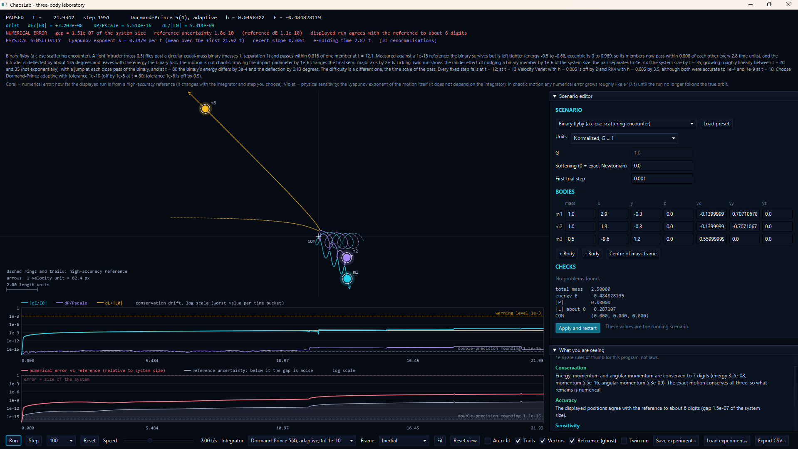
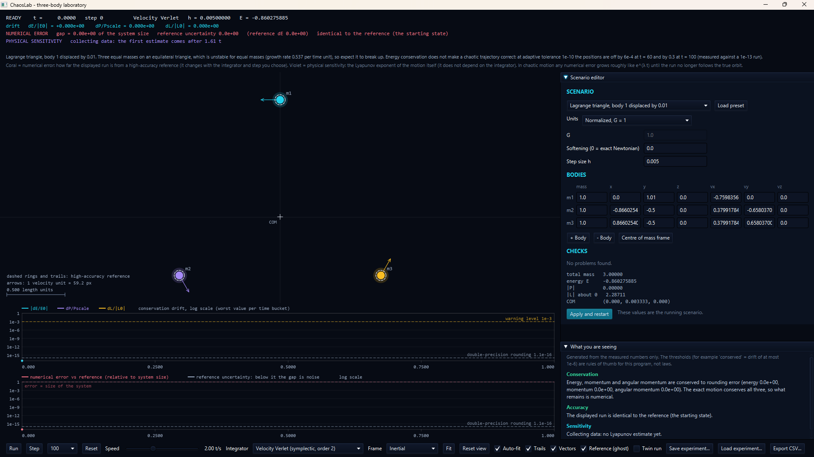

# ChaosLab

[](https://github.com/SaumayAshish/ChaosLab/actions/workflows/ci.yml)

An interactive desktop laboratory for the Newtonian N-body problem and deterministic chaos, written in Java 25 and JavaFX.

ChaosLab is built to answer one question honestly: **when a simulated orbit looks wrong, is that physics or is it the numerics?**
It runs the same system with several integrators, compares each against a high-accuracy reference trajectory, and keeps two
quantities apart on screen:

- **Numerical error** (coral): how far the displayed run is from the reference at the same time.
- **Physical sensitivity** (violet): how fast two nearby starts separate, a property of the motion and not of the integrator.

The physics engine has no dependency on the user interface. The window only reads immutable snapshots.

> Status: working research prototype. 426 automated tests pass (see [Verification](#verification)). The JavaFX classes themselves
> have no automated tests; they were checked by hand in the running window.

## Screenshots



*Binary flyby, Dormand-Prince 5(4) adaptive at tolerance 1e-10, paused at t = 21.93. The status lines read a gap to the
high-accuracy reference of 1.51e-07 of the system size (about 6 digits of agreement), an energy drift of 3.2e-08, and a Lyapunov
exponent of 0.348 per unit time. The right column shows the scenario editor with the generated explanation below it.*



*Lagrange triangle with body 1 displaced by 0.01, velocity Verlet with h = 0.005, at t = 0 before the first step: the numerical
error is exactly zero because the displayed run is the reference's starting state. The preset note states the measured outcome.*

## What it does

- Newtonian gravity in normalised units or SI units, for 2 to 8 bodies. Optional Plummer softening is always labelled non-Newtonian.
- Integrators: explicit Euler, classical RK4, velocity Verlet (symplectic), Dormand-Prince 5(4) with fixed or adaptive steps.
- Live diagnostics: energy, linear momentum and angular momentum drift, measured and never assumed.
- A reference trajectory (Dormand-Prince at tolerance 1e-13 with quintic Hermite interpolation) and its own uncertainty, so the
  window can say when the gap is below what the reference can resolve.
- A Lyapunov exponent (Benettin method) with a rule that refuses to claim an exponent from too little data.
- A twin run: the same system with one body moved by 1e-6 of the system size, to show sensitivity directly.
- A plain-language explanation panel generated only from the measured numbers.
- Save and load experiments as JSON, and export the drift, error and twin curves as CSV.
- Orbit view with trails, velocity vectors, labels, centre-of-mass marker, selectable reference frame, zoom, pan and fit.

## Experiments (presets)

| Preset | What it demonstrates |
|---|---|
| Two bodies, circular and eccentric (e = 0.75) | Kepler baseline; integrator order and conservation |
| Sun and Earth (SI units) | Long-period accuracy of each integrator |
| Lagrange triangle, exact and displaced by 0.01 | An exact solution that is unstable: the exponent is known analytically (0.5372850) |
| Figure-eight choreography | A stable periodic three-body orbit; a 1 % displacement destroys it |
| Pythagorean 3-4-5 problem (Burrau) | Strong chaos with close passes; after a body is ejected, two references at tolerance 1e-13 and 1e-14 disagree by 2.1 at t = 70 |
| Binary flyby | A limitation case: the outcome is not chaotic but fixed steps fail at a close pass (a time-scale problem) |
| Sun, Earth and Moon (SI units) | Hierarchical system; regular motion; the exponent estimate correctly falls toward zero |

Each preset's note in the application states what was measured and how.

## Build and run

Requirements: JDK 25 (a newer JDK compiling with `--release 25` also works), Maven 3.9 or later. No other tools are needed, and
no network is needed after the dependencies are cached.

```
mvn test            # run every test
mvn javafx:run      # start the application
```

Command-line experiments that need no window:

```
mvn -q compile
java -cp target/classes dev.chaoslab.cli.ChaosDemo
```

## Verification

- 426 JUnit 5 tests in 34 classes cover the physics, integrators, reference track, Lyapunov tracker, twin run, scenario
  validation, JSON and CSV input and output, and the explanation logic. Numbers quoted in the preset notes are pinned by tests.
- Test strength was checked by mutation: a deliberate fault was introduced into the code and the test run had to fail. Faults
  that survived led to stronger tests or to removal of dead code (recorded in the milestone log).
- Convergence orders measured: Euler 0.99, RK4 4.06, Verlet 2.00, Dormand-Prince fixed step 5.15 to 5.34.
- The first continuous-integration run (2026-10-26) passed on Ubuntu and Windows.
- See [docs/REPRODUCIBILITY.md](docs/REPRODUCIBILITY.md) for exactly what is and is not claimed.

## Documentation

- [Architecture decision records](docs/adr/) explain why the code is the way it is.
- [Roadmap](docs/ROADMAP.md) lists what is deliberately not done yet.

## Known limitations

- The orbit view draws the x-y projection.
- The reference is itself a numerical solution and has a predictability horizon; the window reports when the gap falls below it.
- Adaptive stepping needs Dormand-Prince specifically. It is not symplectic, so energy drifts slowly over very long runs.
- The twin run draws rings only (no trails) and always nudges body 0 along +x.
- Development so far has run on JDK 26 compiling with `--release 25`, not yet on a Java 25 runtime.

## Licence

MIT. See [LICENSE](LICENSE).
